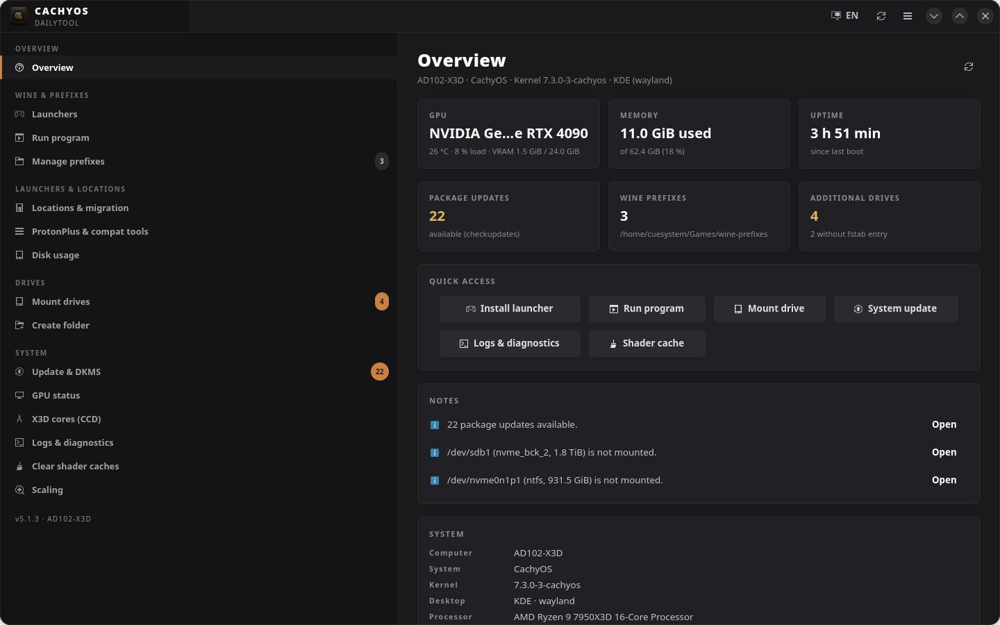
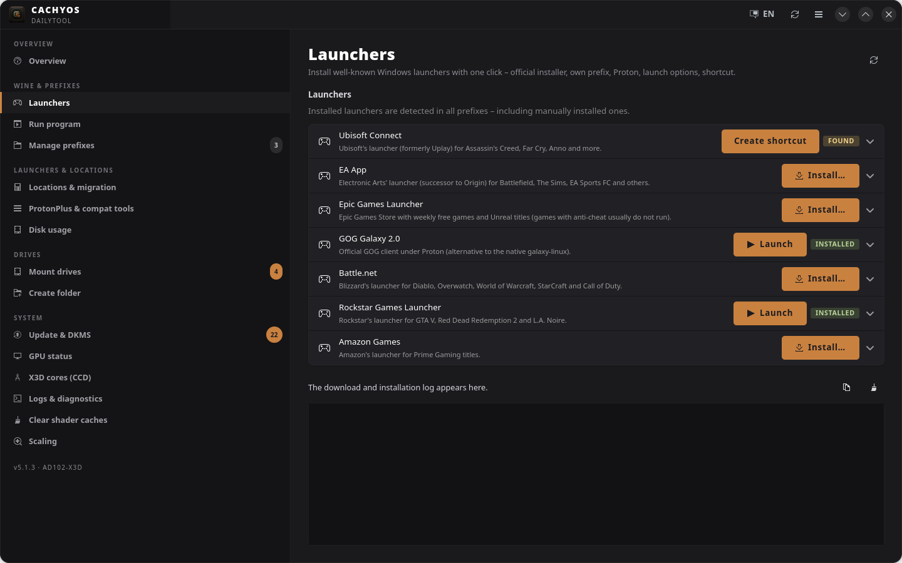
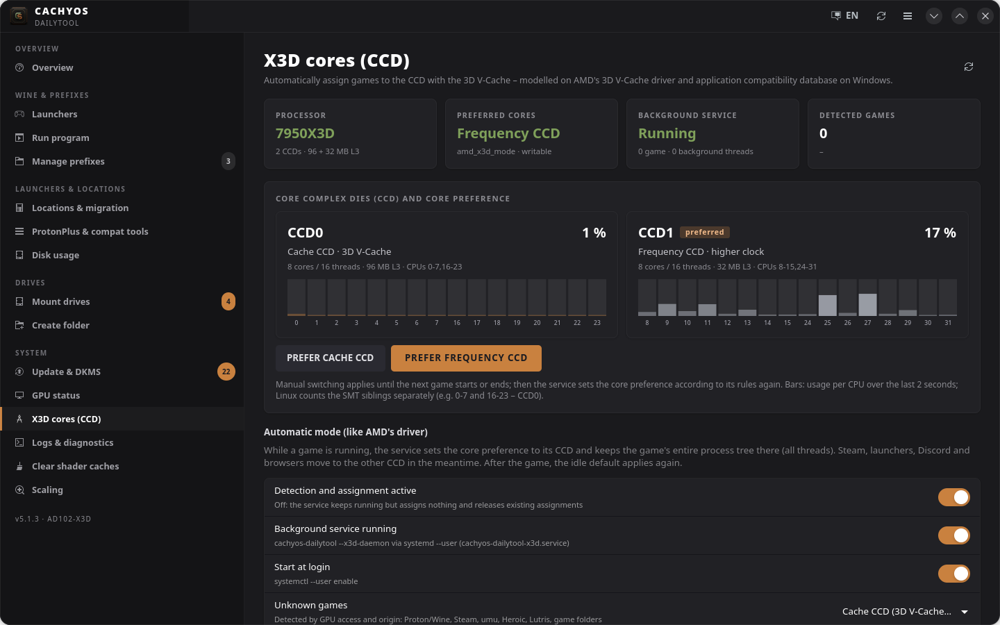

# CachyOS DailyTool

An everyday GTK4/libadwaita tool for **CachyOS / Arch Linux**: Windows launchers and Wine/Proton prefixes,
X3D core assignment, drives, GPU and system updates – in one window, every function one click away.



## Core features

- **Windows launchers in one click** – Ubisoft Connect, EA App, Epic Games, GOG Galaxy, Battle.net, Rockstar and Amazon:
  official installer, own prefix, tested Proton settings, start menu and desktop shortcut.
- **Wine & Proton prefixes** – run any .exe/.msi; per prefix and app: runner (Proton via umu, Proton, Wine),
  Steam-style launch options with GOverlay import, Wayland driver, DPI matched to your desktop scaling;
  backup, rename, move, uninstall.
- **X3D core assignment (CCD)** – for Ryzen 7950X3D/7900X3D/9950X3D/9900X3D: a background service detects running games
  and keeps them on the 3D V-Cache CCD while Steam, launchers and browsers move to the other one, like AMD's Windows driver.
- **Drives** – mount NVMe/SATA/USB partitions permanently via fstab (with preview and backup), format, create folders.
- **System** – pacman update with DKMS and kernel check, live GPU status, journal filters, shader cache cleanup,
  ProtonPlus and compat tools, desktop scaling.
- **English and German** – switch with the language icon in the header bar; the app restarts on the same page.

| Launchers | X3D cores |
|---|---|
|  |  |

## Install

Required: `python`, `python-gobject`, `gtk4`, `libadwaita`, `polkit`, `xdg-utils`, `rsync`.
Recommended: `umu-launcher`, `proton-cachyos`, `wine`, `winetricks`, `mangohud`, `gamemode`, `goverlay`, `pacman-contrib`.

```bash
git clone https://github.com/Cue-System90/CachyOS-DailyTool.git
cd CachyOS-DailyTool
bash install.sh             # user install to ~/.local, no root
bash install.sh --system    # or: build a pacman package and install it
```

Start it from the app menu (**CachyOS DailyTool**) or with `cachyos-dailytool`. It replaces the older `cachy-toolkit`
(“CachyOS Alltagstool”); existing settings are kept.

## Uninstall

```bash
bash install.sh --uninstall           # add --purge to also delete settings and logs
```

Wine prefixes and prefix backups stay; `--prefixes` deletes them too, including games installed inside the prefixes.

## Development

```bash
python3 -m unittest discover -s tests -t .   # tests
python3 -m cachyos_dailytool                 # run from the source tree
scripts/i18n-update.py en                    # update the English catalogue after changing texts
```

Settings: `~/.config/cachy-daily-toolkit/config.env` · Logs: `~/.local/share/cachy-daily-toolkit/logs/`

## License

MIT
